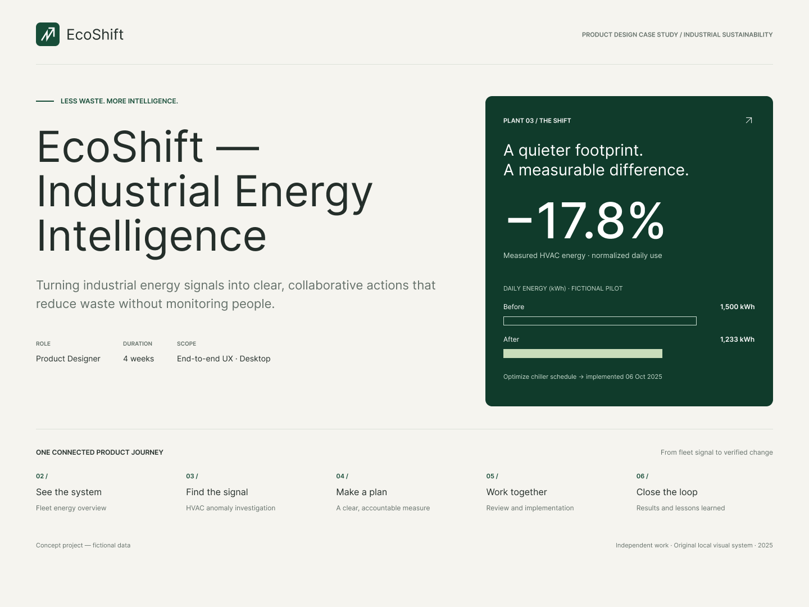
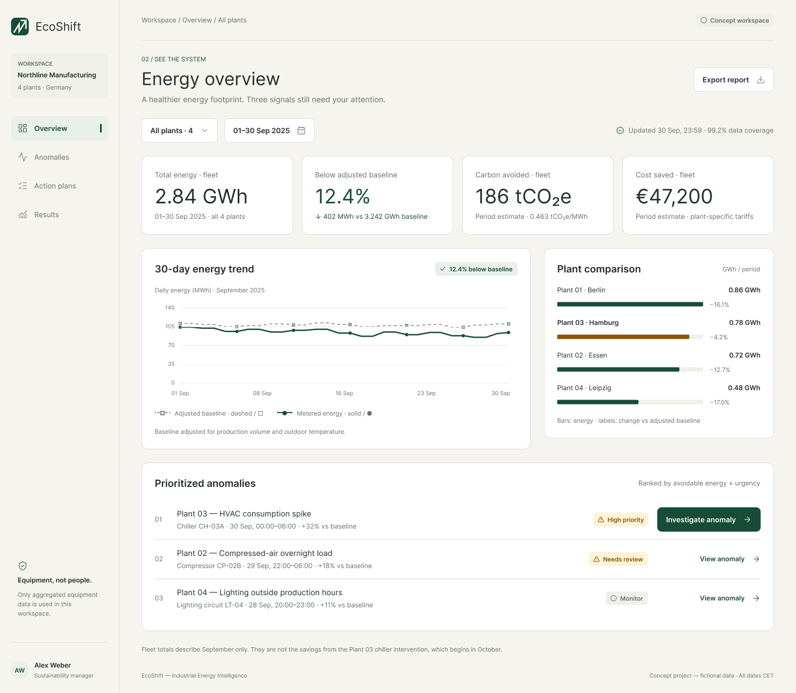
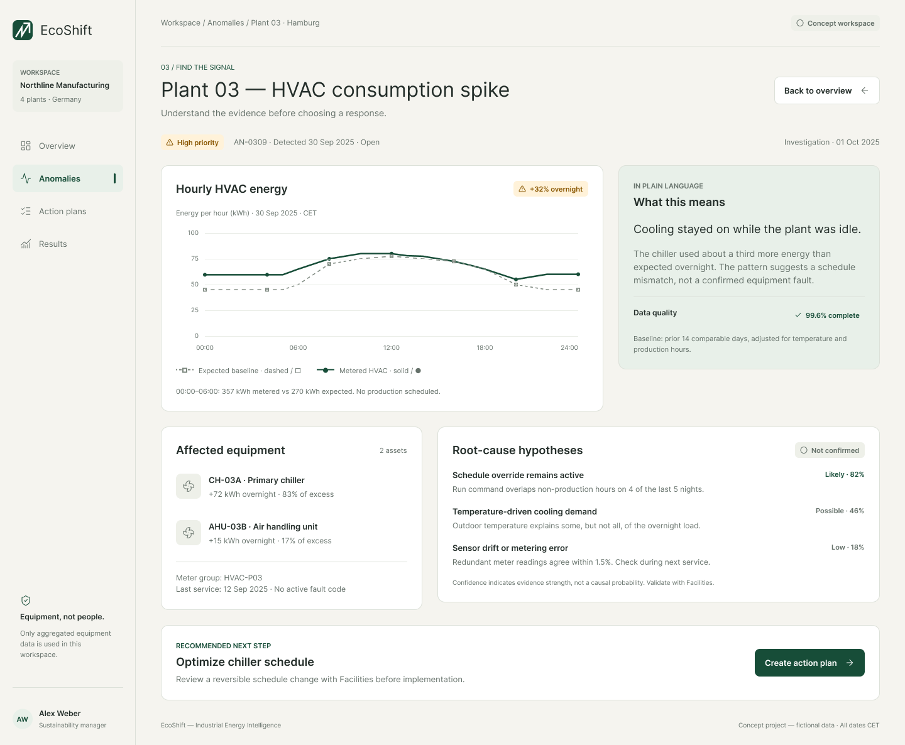
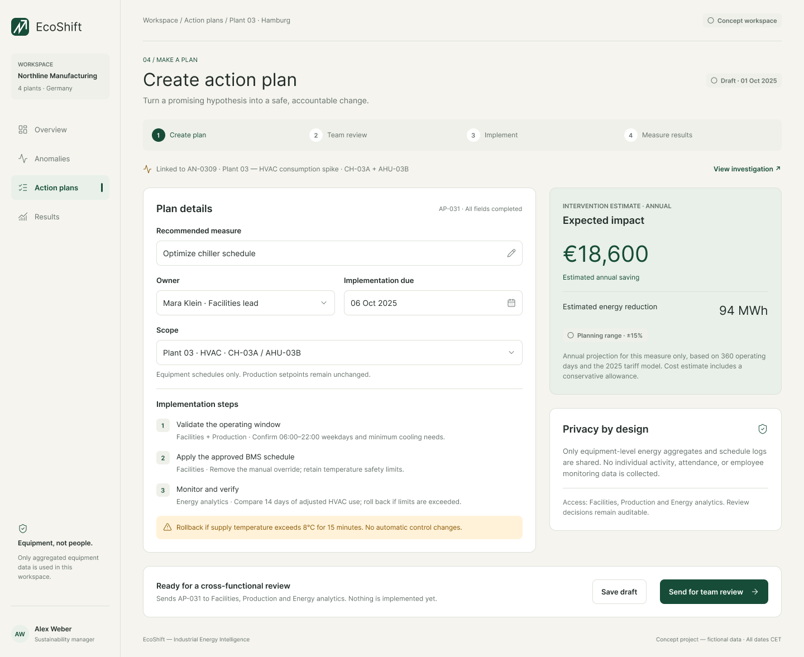
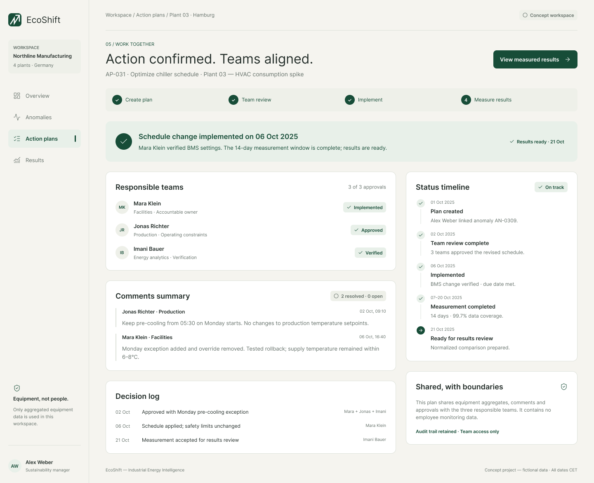
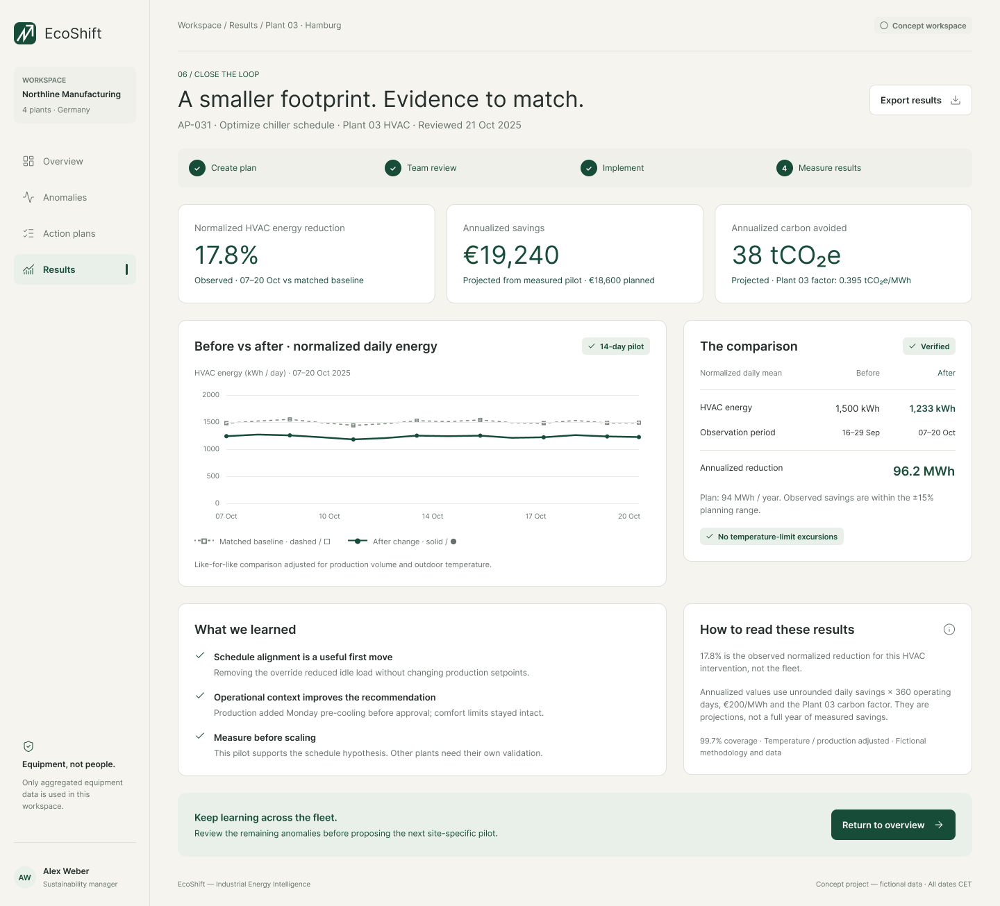

# EcoShift — Industrial Energy Intelligence

An original desktop UX concept that helps sustainability teams move from an energy anomaly to a measured, accountable intervention.

> Concept project · Fictional data · Independent work · 2025

[Open the editable Figma file](https://www.figma.com/design/GaIWHInzvJ0w6pqP5xpo7W/EcoShift-%25E2%2580%2594-Industrial-Energy-Intelligence-UX-Case-Study)

## The challenge

Industrial energy tools often expose large amounts of telemetry without helping a sustainability manager decide what deserves attention, why it happened, or whether a change worked. EcoShift turns that fragmented workflow into one connected journey:

**See the system → Find the signal → Make a plan → Work together → Close the loop**

The primary user is a sustainability manager responsible for several manufacturing plants. The concept assumes collaboration with facilities, production, and energy-analytics teams.

## Design principles

- **Clarity before density** — show the evidence required for a decision, then progressively disclose detail.
- **Equipment, not people** — use aggregated equipment and schedule data; avoid individual monitoring.
- **Explain the recommendation** — pair analytical signals with a plain-language interpretation and confidence.
- **Make ownership visible** — decisions, approvals, safety constraints, and accountable owners remain traceable.
- **Measure before scaling** — compare like-for-like operating periods before presenting projected impact.
- **Accessible by default** — use labeled charts, strong contrast, text status, and redundant visual encodings.

## Product journey

### 1. See the system

The overview prioritizes four fleet metrics, a baseline-aware trend, plant comparison, and three ranked anomalies. The interface distinguishes fleet-period performance from the later Plant 03 pilot result.

### 2. Find the signal

The investigation view explains the overnight HVAC spike using a labeled hourly comparison, affected assets, evidence-strength indicators, and a plain-language summary. Hypotheses are clearly marked as unconfirmed.

### 3. Make a plan

The proposed schedule change includes an accountable owner, implementation steps, an expected-impact range, rollback conditions, privacy boundaries, and a review gate before implementation.

### 4. Work together

The collaboration state records approvals, resolved comments, implementation status, the decision log, and the boundary between shared equipment data and employee monitoring.

### 5. Close the loop

The result view compares normalized operating periods and distinguishes observed pilot reduction from annualized projections. It closes with lessons that support — but do not overstate — future scaling.

## Outcome represented in the prototype

| Measure | Result |
| --- | ---: |
| Normalized HVAC energy reduction | 17.8% |
| Annualized savings projection | €19,240 |
| Annualized carbon avoided | 38 tCO₂e |
| Measurement window | 14 days |

These figures are fictional and exist only to demonstrate the product narrative, information hierarchy, and measurement design.

## Deliverables

- Six editable 1440px desktop frames
- Local component and visual system in Figma
- Baseline-aware trend and comparison patterns
- Privacy, uncertainty, and safety states
- End-to-end anomaly-to-results workflow
- GitHub-ready visual case study

## Tools

Figma · Auto Layout · Components · Prototyping · UX writing · Data visualization · Accessibility review

